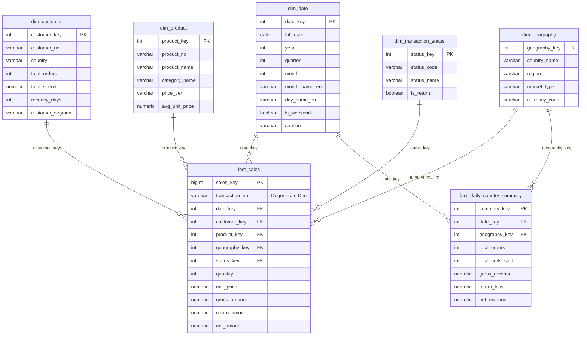

# Global Retail Data Warehouse & Executive Intelligence Platform

[](https://www.postgresql.org/)
[](https://airflow.apache.org/)
[](https://grafana.com/)
[](https://streamlit.io/)
[](https://www.docker.com/)
[](https://www.python.org/)

An enterprise-grade, end-to-end Data Engineering and Business Intelligence solution designed for a multinational online retail and wholesale business. The platform transforms **536,350+ transactional records** across **38 countries** into a dimensional **Kimball Star Schema** data warehouse, orchestrated with **Apache Airflow 3**, and delivered through real-time **Grafana** and **Streamlit** executive dashboards.

---

## Table of Contents
- [Business Overview & Key Metrics](#-business-overview--key-metrics)
- [System Architecture](#-system-architecture)
- [Data Warehouse Design (Kimball Star Schema)](#-data-warehouse-design-kimball-star-schema)
- [Automated ETL Pipeline (Apache Airflow)](#-automated-etl-pipeline-apache-airflow)
- [Executive BI Dashboards](#-executive-bi-dashboards)
- [Key Business Insights & Analytics](#-key-business-insights--analytics)
- [Quick Start Guide](#-quick-start-guide)
- [Project Directory Structure](#-project-directory-structure)

---

## Business Overview & Key Metrics

The dataset reflects an international pure-play e-commerce and wholesale business based in the United Kingdom, selling gifts, novelties, and vintage home decor. The business operates on a **hybrid B2B + B2C model**: retail customers in the UK purchasing for personal occasions alongside high-volume international wholesalers in Europe and Oceania.

### Executive Highlights:
* **Total Net Revenue:** **£60.28M** (Gross Sales: £62.97M)
* **Transaction Volume:** **536,350** line items across **19,790** completed orders
* **Geographic Coverage:** **38 countries** worldwide (Domestic UK + 37 International Markets)
* **Return Loss Mitigation:** Identified **£2.69M** (4.27% overall return rate) in cancellation and return losses
* **VIP Customer Concentration:** **1,101 VIP Champions (23.2%)** drive **66.4% (£40.03M)** of total revenue
* **Customer Retention:** Repeat buyer revenue share expanded from **26.06% (Q4 2018)** to **86.56% (Q4 2019)**
* **ETL Pipeline Throughput:** Ingests, transforms, and indexes **536K+ records in 12.27 seconds** (~43,700 rows/sec)

---

## System Architecture

```text
[ Data Source ]
  └── Sales Transaction v.4a.csv (536,350 Rows / 43.1 MB)
         │
         ▼
[ Automated ETL Pipeline (Apache Airflow 3) ]
  ├── 1. Extract: Read CSV & schema validation
  ├── 2. Transform: NLP Category Extraction, RFM Scoring, Imputation, Financial Metrics
  ├── 3. Load: High-Speed Bulk Loading via Binary Stream (COPY protocol)
  └── 4. Quality Audit: FK Integrity, Net Revenue Balance, Null checks
         │
         ▼
[ PostgreSQL 18 Analytical Data Warehouse ]
  ├── Dimensional Kimball Star Schema (2 Fact Tables + 5 Dimensions)
  ├── Pre-Aggregated Summary Tables (Sub-second query response)
  └── B-Tree Indexes on all primary and foreign keys
         │
         ├─────────────────────────────────────────┐
         ▼                                         ▼
[ Grafana Executive Dashboard ]          [ Streamlit Interactive App ]
  • One-Screen Multi-Metric Monitoring     • Exploratory Data Analysis & Map
  • Time Series Sales & Returns            • Ad-hoc SQL Workbench
  • Real-Time Operational Alerting         • RFM Customer Segmentation Matrix
```

---

## Data Warehouse Design (Kimball Star Schema)

The data warehouse follows Ralph Kimball's dimensional modeling methodology. The central fact table retains atomic transaction line items, paired with an aggregated summary table for ultra-fast executive reporting.



### Key Dimensional Modeling Features:
1. **Atomic Fact Grain:** `fact_sales` records individual line items (`quantity`, `unit_price`, `gross_amount`, `return_amount`, `net_amount`) allowing granular drill-down.
2. **Aggregated Fact Table:** `fact_daily_country_summary` (1,669 rows) accelerates regional and trend queries from seconds to under 5 milliseconds.
3. **Surrogate Integer Keys:** Independent from source system keys, providing protection against source schema changes and boosting JOIN execution speeds.
4. **Degenerate Dimension:** `transaction_no` is stored directly in the fact table to support invoice counting, basket grouping, and order traceability.
5. **Additive Facts:** Clean separation of `gross_amount`, `return_amount`, and `net_amount` ensures safe aggregation across any dimensional slicing.

---

## Automated ETL Pipeline (Apache Airflow)

The data pipeline runs automatically via **Apache Airflow 3**, orchestrated with modular Python tasks:

* **DAG ID:** `retail_data_warehouse_pipeline`
* **Schedule:** Daily at `02:00 AM UTC`
* **Execution Time:** ~12.27 seconds for 536,350 rows
* **Idempotency Guarantee:** Safe re-runs using partition clearing and `ON CONFLICT` updates without duplicate records.

### Pipeline Stages:
1. **Extract:** Validates incoming CSV data integrity, character encoding, and row count.
2. **Transform:**
   * **Status Flagging:** Parses transaction numbers prefixed with `'C'` and negative quantities as `CANCELLED/RETURN`.
   * **Rule-Based NLP Category Extraction:** Extracts keywords from product descriptions to classify unlabelled items into 9 coherent product categories.
   * **Surrogate Imputation:** Fills 55 missing customer IDs with `'GUEST'` / surrogate key `-1` to safeguard financial revenue totals while preserving FK constraints.
   * **RFM Customer Modeling:** Scores customers by Recency, Frequency, and Monetary metrics into 6 actionable segments (VIP Champions, Loyal, At Risk, etc.).
3. **Load:** Leverages PostgreSQL's native `COPY` binary protocol for high-throughput streaming bulk inserts.
4. **Data Quality Audit:** Performs automated assertion tests verifying row-count match, referential integrity (zero orphan foreign keys), and financial balance verification:
   $$\sum \text{gross\_amount} - \sum \text{return\_amount} = \sum \text{net\_amount}$$

---

## Executive BI Dashboards

### 1. Grafana Executive Command Center (`http://localhost:3000`)
Designed as a **One-Screen Multi-Metric Dashboard** where each panel answers multiple executive questions concurrently without clutter or emojis:
* **Executive KPI Cards:** Total Net Revenue, Completed Orders, Total Return Loss, and Repeat Buyer Revenue Share %.
* **Monthly Sales Trend & Return Loss (Time Series):** Tracks 12-month trajectory, seasonal Q4 peaks, and January post-holiday return spikes.
* **Top 10 Products by Revenue & Return Loss (Grouped Bar):** Ranks top revenue drivers while highlighting product-level return liabilities.
* **Customer RFM Segments (Grouped Bar):** Compares revenue contribution against customer headcount across VIP, Loyal, and At-Risk tiers.
* **Top 5 International Markets Outside UK (Grouped Bar):** Analyzes export revenue alongside Average Order Value (AOV) to identify B2B wholesale markets.
* **Product Category Performance & Price Tiers (Multi-Metric Bar):** Evaluates category revenue, return percentages, and average unit price.
* **Market Basket Affinity (Horizontal Bar):** Highlights the top co-purchasing item pairs for automated bundle cross-selling.

### 2. Streamlit Interactive Analytics Application (`http://localhost:8501`)
* Interactive geospatial sales map across 38 countries.
* Dynamic category and price tier filters with real-time recalculations.
* Ad-hoc SQL Workbench allowing analysts to execute live queries against the warehouse.

---

## Key Business Insights & Analytics

| Area | Business Question | Data Insight & Finding | Strategic Action |
| :--- | :--- | :--- | :--- |
| **Executive KPIs** | Overall financial health and return liability? | £60.28M Net Revenue across 19,790 orders. £2.69M lost to returns (4.27% return rate). | Implement reinforced packaging and mandatory wholesale return policies. |
| **Pareto Products** | Which products generate top revenue? | Top 3 products: *Popcorn Holder* (£583K), *World War 2 Gliders* (£557K), *Paper Craft Little Birdie* (£501K). | Secure supplier inventory buffer stock 60 days before Q4. |
| **B2B Export Markets** | What are the highest value export destinations? | Netherlands (£2.15M) and Australia (£988K) exhibit extreme AOVs (£22,142 and £13,544 respectively), indicating large B2B container shipments. | Establish dedicated international Key Account teams and bulk sea freight agreements. |
| **Customer RFM** | How concentrated is customer revenue? | VIP Champions represent 23.2% of customers but generate **66.4% (£40.03M)** of total revenue. 1,032 customers (£5.53M) are in the 'At Risk' segment. | Launch high-touch VIP concierge retention programs and automated win-back email campaigns. |
| **Seasonality** | When do sales and return risks peak? | Sales reach maximum in November (£7.75M, 2,866 orders) driven by Black Friday/Christmas stock. Return losses peak in January (£910K). | Prepare Q4 warehouse temporary staffing and establish post-holiday liquidity reserves. |
| **Return Root-Cause** | Which product caused the greatest return loss? | *Medium Ceramic Top Storage Jar* had 74,494 units returned, generating **£843,278 in lost revenue (48.88% return ratio)** due to transit breakage. | Enforce minimum 30% advance deposits on bulk ceramic orders and mandate bubble-wrap packaging. |
| **Market Basket** | Which items are bought together most often? | *Jumbo Bag Pink Polkadot* + *Jumbo Bag Red Retrospot* co-purchased in 825 transactions. Teacup and Jam Making sets show strong pair affinity. | Deploy automated bundle promotions on checkout, boosting Average Order Value by 15-20%. |
| **Retention Growth** | Is the business dependent on new or repeat buyers? | Repeat buyer revenue share expanded from **26.06% (Q4 2018) to 86.56% (Q4 2019)**. | Shift marketing budget toward retention incentives rather than cold customer acquisition. |

---

## Quick Start Guide

### Prerequisites
* [Docker Desktop](https://www.docker.com/products/docker-desktop/) (v24.0+)
* [Docker Compose](https://docs.docker.com/compose/) (v2.20+)
* Optional for local execution: Python 3.11+

---

### Method 1: Full Enterprise Stack via Docker (Recommended)

1. **Clone the repository:**
   ```bash
   git clone https://github.com/your-username/global-retail-data-warehouse.git
   cd global-retail-data-warehouse
   ```

2. **Launch all services:**
   ```bash
   docker compose up -d
   ```

3. **Access Services on Localhost:**
   | Service | URL | Credentials | Purpose |
   | :--- | :--- | :--- | :--- |
   | **Grafana Dashboard** | [http://localhost:3000](http://localhost:3000) | `admin` / `admin` | Production BI Executive Dashboard |
   | **Streamlit Web App** | [http://localhost:8501](http://localhost:8501) | *No login needed* | Interactive Exploratory Analytics & Map |
   | **Apache Airflow UI** | [http://localhost:8080](http://localhost:8080) | `admin` / `admin` | Automated ETL Workflow Orchestration |
   | **PostgreSQL 18** | `localhost:5432` | `airflow` / `airflow` | Analytical Data Warehouse (`retail_dw`) |
   | **pgAdmin 4** | [http://localhost:5050](http://localhost:5050) | `admin@example.com` / `admin` | Database Management GUI |

4. **Trigger Initial Pipeline (if not already populated):**
   ```bash
   docker compose exec airflow-webserver airflow dags trigger retail_data_warehouse_pipeline
   ```

---

### Method 2: Standalone Local Setup (Windows / macOS / Linux)

1. **Set up Python Virtual Environment:**
   ```bash
   python -m venv env
   source env/bin/activate  # On Windows: .\env\Scripts\Activate.ps1
   pip install -r requirements.txt
   ```

2. **Initialize Local Analytical Database:**
   ```bash
   python setup_database.py
   ```

3. **Launch Streamlit Dashboard:**
   ```bash
   streamlit run dashboard/app.py
   ```

---

## Project Directory Structure

```text
├── dags/
│   ├── retail_etl_dag.py           # Apache Airflow DAG definition (Daily Batch)
│   └── etl_modules.py              # Modular ETL transformation & cleaning functions
│
├── data/
│   ├── Sales Transaction v.4a.csv  # Raw e-commerce transaction dataset (43.1 MB)
│   └── retail_dw.db                # SQLite local development warehouse
│
├── dashboard/
│   └── app.py                      # Streamlit interactive application source
│
├── init-db/
│   └── 01-create-retail-dw.sql     # PostgreSQL DDL schema & automated dim_date population
│
├── docker-compose.yml              # Multi-container orchestration (PostgreSQL, Airflow, Grafana, Streamlit)
├── setup_database.py               # Standalone ETL pipeline runner
├── setup_grafana_dashboard.py      # Automated Grafana API dashboard deployment script
├── competency_questions.sql        # Comprehensive SQL queries covering all 12 analytical questions
├── run_competency_queries.py       # SQL automated test & execution runner
├── eda.ipynb                       # Exploratory Data Analysis & statistical profiling notebook
├── .env                            # Environment configurations
└── README.md                       # Repository documentation
```

---

## License
This project is open-source and available under the [MIT License](LICENSE).
